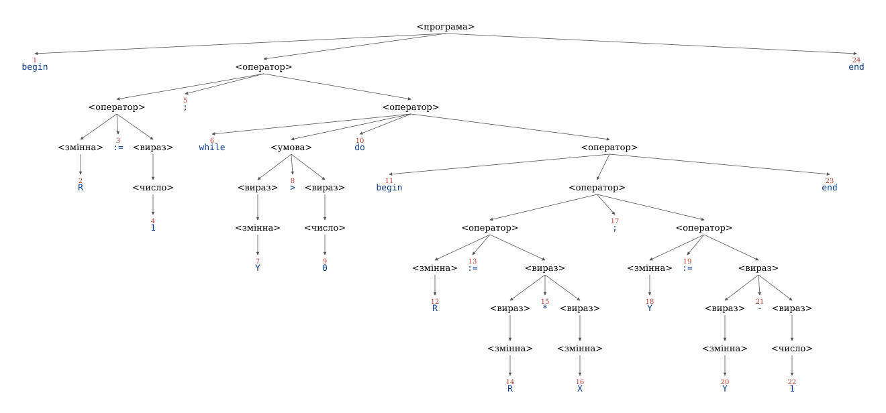

# SIPL Language Toolkit

Grammar, parser and typed AST for **SIPL** (SImple Programming Language), the teaching
language of the "Theory of Programming" course. Course project (max 10 points).

## Chosen tasks

| ID | Task | Points | Status |
|---|---|---|---|
| CORE-01 | Machine-readable grammar (Lark), 10+ valid / 10+ invalid tests | 0.5 | done |
| CORE-02 | Parser and typed AST with `SourceSpan`, syntax diagnostics | 1.5 | done |
| CORE-03 | Interpreter: state, assignment, sequence, if, while, begin/end, skip, step limit | 2.0 | done |
| CORE-04 | Execution events and trace (programmatic and JSON) | 1.0 | done |
| CORE-05 | CLI: parse, check, run, trace (plus term, tree) with JSON mode | 1.0 | done |
| CORE-06 | Conformance suite: programs with expected AST, state and errors | 1.0 | done |
| VIS-01 | Parse tree visualization (text, JSON, DOT/SVG), nodes linked to source fragments | 1.5 | done |
| SEM-01 | Semantic term built from the AST in the notation of the course, golden tests | 2.0 | done |
| | **Total** (the project is graded up to 10.0) | **10.5** | |

## Install and test

```bash
python -m venv .venv && source .venv/bin/activate   # Windows: .venv\Scripts\activate
pip install -e ".[dev]"
pytest --cov=sipl
```

## Command line

```bash
sipl check examples/gcd.sipl
sipl run examples/power.sipl --var X=5 --var Y=2          # prints R = 25, X = 5, Y = 0
sipl trace examples/power.sipl -v X=2 -v Y=1 --json       # machine-readable trace
sipl parse examples/gcd.sipl                              # AST as a tree
sipl term examples/power.sipl                             # semantic term: ASR(1) · WH(S²(gr, Y⇒, 0), ...)
sipl tree examples/power.sipl --format svg -o tree.svg    # parse tree: text, json, dot or svg
```

Commands `parse`, `check`, `run`, `trace`, the options, the exit codes (0 ok, 1 syntax error, 2 usage,
3 runtime error, 4 input error) and the JSON schema are described in [docs/cli.md](docs/cli.md).

## Python API

```python
from sipl import parse, run, trace, SiplSyntaxError

program = parse(open("examples/power.sipl", encoding="utf-8").read())
print(program.body)           # typed AST: Seq(Assign(...), While(...))
print(program.span)           # SourceSpan: offsets, 1-based line/column

final = run(program, {"X": 5, "Y": 2})   # State: R=25, X=5, Y=0
print(dict(final))

t = trace(program, {"X": 5, "Y": 2})      # events: BeforeStatement, VariableChanged, ...
print(t.final_state, len(t.events))
print(t.to_json(indent=2))                # JSON format: docs/trace-format.md

try:
    parse("begin\n  x := ;\nend")
except SiplSyntaxError as err:
    print(err.line, err.column, err)   # 2 8  line 2, column 8: unexpected ';', expected ...
```

## Language notes

The grammar follows the course BNF (`src/sipl/grammar/sipl.lark`):

- statements: `x := a`, `S1 ; S2`, `if b then S1 else S2`, `while b do S`, `begin S end`, `skip`;
- expressions: `+ - *`, parentheses, integer literals (negative literals allowed);
- conditions: `=`, `>`, `¬`, `∨`, parentheses (the symbols `¬` and `∨` are used as in the course);
- priority, highest first: `*`, `+ -`, `= >`, `¬`, `∨`; all binary operations are left-associative;
- `;` separates statements and binds loosest, so `while b do S1; S2` is `(while b do S1); S2`;
  a `;` before `end` is a syntax error, as in the course BNF;
- `div` and `mod` are not part of the course BNF and are not supported (they would be a separate extension);
- the AST is abstract syntax: parentheses are not nodes.

## Execution semantics

- The state is a finite partial map `Var -> Int` (`sipl.State`, immutable). A variable that is not in
  the state is undefined; reading it raises `UndefinedVariableError` with the source position.
  Assignment creates the variable if needed (`st∇[x ↦ v]`).
- `∨` is strict as in the course semantics: both operands are always evaluated.
- Infinite loops are stopped by a step limit (`run(..., max_steps=...)`, default 1 000 000), which
  raises `StepLimitExceeded` with the loop position and the current state. One step is an
  assignment, a `skip`, an `if` condition check, or a `while` condition check.
- `run` returns a new state; the initial state is never modified.

## Trace

`trace(program, initial)` records every execution event (statement start/end, variable change,
condition check, termination or failure). A runtime error ends the trace with a `Failed` event instead of
raising. The event model and the JSON format are described in [docs/trace-format.md](docs/trace-format.md).

## Semantic terms

`sipl term` translates the AST into the semantic term of the program algebra by the rules `sem_P`, `sem_S`,
`sem_A`, `sem_B` of the course, and prints it in the course notation. The terms of `examples/gcd.sipl` and
`examples/power.sipl` equal those of the course book and the workbook, and the tests evaluate the terms of the
conformance programs back to the expected states. See [docs/semantics.md](docs/semantics.md).

## Parse tree

`sipl tree` draws the parse tree of a program in the notation of the course BNF (all terminals numbered
left to right, as in the workbook figures) as text, JSON, DOT or a standalone SVG. Every node is linked to its
source fragment (spans in all formats, `data-*` attributes and tooltips in the SVG). The picture is generated
from the real parser output; see [docs/visualization.md](docs/visualization.md).



## Conformance suite

`conformance/` holds a language-neutral suite (93 cases: expected AST, final state, syntax and runtime errors)
and a stand-alone runner that tests any implementation providing the `parse` / `run` JSON contract:

```bash
python conformance/run.py                          # this implementation
python conformance/run.py --command "./my-sipl"    # another one
```

The case format, the AST notation and the contract are documented in
[conformance/README.md](conformance/README.md). The tests of this repository also check that the suite
is able to fail: deliberately broken implementations (wrong operator, lazy `∨`, reversed statement order,
right-associative operators) are detected.

## Layout

```
src/sipl/grammar/sipl.lark   formal grammar
src/sipl/ast.py              typed AST nodes, SourceSpan, walk()
src/sipl/parser.py           parse(), SiplSyntaxError
src/sipl/interpreter/        State, run(), Interpreter, events, trace(), runtime errors
src/sipl/semantics/         semantic terms (sem_P, sem_S, sem_A, sem_B)
src/sipl/visualization/     parse tree: text, JSON, DOT, SVG
src/sipl/cli.py              command-line interface
conformance/                 conformance suite and runner
docs/                        CLI, trace, visualization and semantic term formats
examples/                    SIPL programs
tests/                       pytest suite
```
