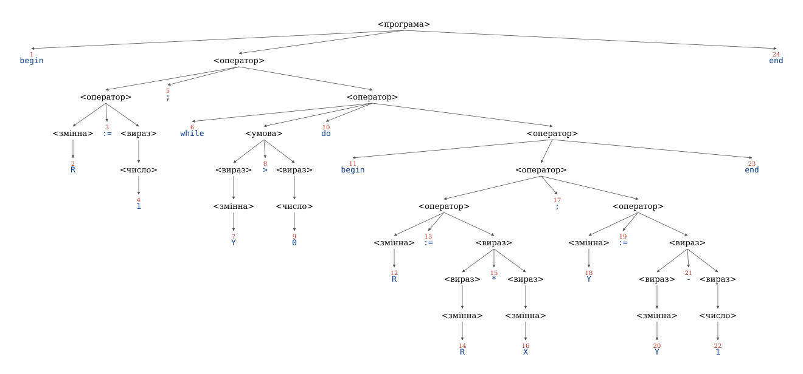

# Parse tree visualization

`sipl tree` draws the **parse tree** (derivation tree) of a program in the notation of the course BNF, as in
the workbook figures. It is not the AST: the AST is abstract syntax, the parse tree is concrete syntax.

| | Parse tree (`sipl tree`) | AST (`sipl parse`) |
|---|---|---|
| terminals (`begin`, `:=`, `;`, `(`, `)`, ...) | kept, numbered left to right | dropped |
| categories | `<програма>`, `<оператор>`, `<вираз>`, `<умова>`, `<змінна>`, `<число>` | node types (`Assign`, `BinOp`, ...) |
| parentheses | terminals `(` and `)` | not represented |
| `x`, `1` | `<вираз>` → `<змінна>` → `x`, `<вираз>` → `<число>` → `1` | `Var`, `Num` |
| `S1 ; S2 ; S3` | `<оператор>` → `<оператор>` `;` `<оператор>`, left-nested | `Seq(Seq(S1, S2), S3)` |

The tree is built from the real parser output (the same grammar, with all tokens kept) and then mapped to the
productions of the course BNF; nothing is drawn by hand. Priorities and associativity decide the shape, so a
program has exactly one tree.



*Generated by `sipl tree examples/power.sipl --format svg -o docs/power-parse-tree.svg`. Its terminals are
numbered as in the workbook figure: `begin` is 1, `end` is 24.*

## Formats

```
sipl tree FILE [--format text|json|dot|svg] [--output FILE]
```

**text** (default): an indented tree. Each line shows the source position `line:column-line:column`;
nonterminal lines also show the source fragment, terminals show their number. The last line is the check
from the workbook: the terminals read left to right must spell the program.

```
<програма>  [1:1-1:15]  begin skip end
  1: begin  [1:1-1:6]
  <оператор>  [1:7-1:11]  skip
    2: skip  [1:7-1:11]
  3: end  [1:12-1:15]

terminals: 1 begin 2 skip 3 end
```

**json**: `{"version":1,"status":"ok","tree":<node>}`. A node is
`{"symbol": ..., "kind": "nonterminal", "span": {...}, "children": [...]}` or
`{"symbol": ..., "kind": "terminal", "span": {...}, "number": N}`. `span` has the form of the
[trace format](trace-format.md): 1-based lines and columns, 0-based offsets, `end` exclusive.

**dot**: Graphviz source. Terminals show their number above the text; every node has a `tooltip` with the
position and the source fragment.

**svg**: a standalone SVG on a white background; it needs no Graphviz. Every node is a
`<g class="node terminal|nonterminal">` with `data-start`, `data-end` (offsets), `data-line`, `data-column`,
`data-end-line`, `data-end-column` and a `<title>` tooltip with the source fragment, so a web page or an
editor can link nodes to the code. Boxes on one level never overlap.

## Python

```python
from sipl.visualization import build_parse_tree, to_svg, to_text, to_dot, to_dict

tree = build_parse_tree(source)       # raises SiplSyntaxError for an invalid program
print(tree.numbered_leaves())         # 1 begin 2 R 3 := ...
svg = to_svg(tree)
```

`ParseTree.root` is a `ParseNode` (`symbol`, `children`, `span`, `number` for terminals); `nodes()` and
`leaves()` traverse it, `fragment(node)` returns the source text of a node.

## Limits

A program with about a thousand statements in a row (or a single expression of that length) is too deep
for the JSON rendering. `sipl tree --format json` reports it as `NestingTooDeep` (exit code 3); text, DOT and
SVG have no such limit.
